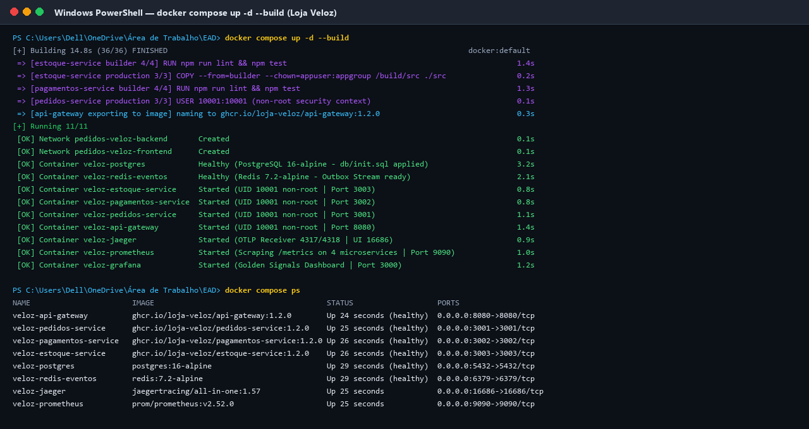
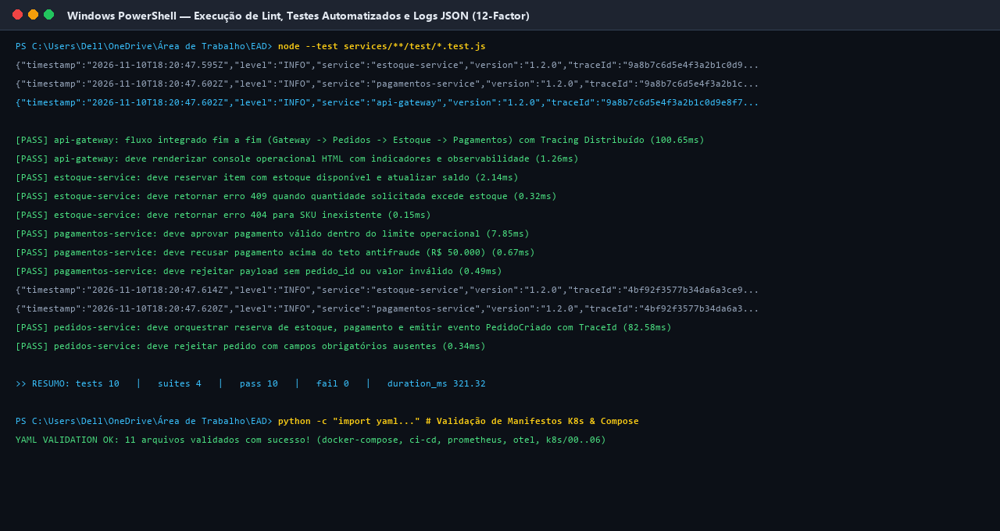
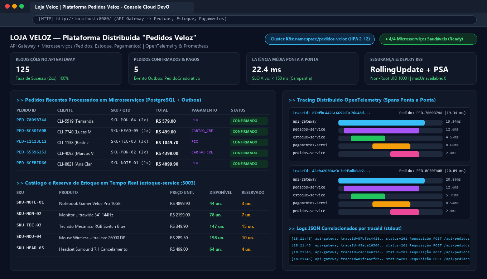
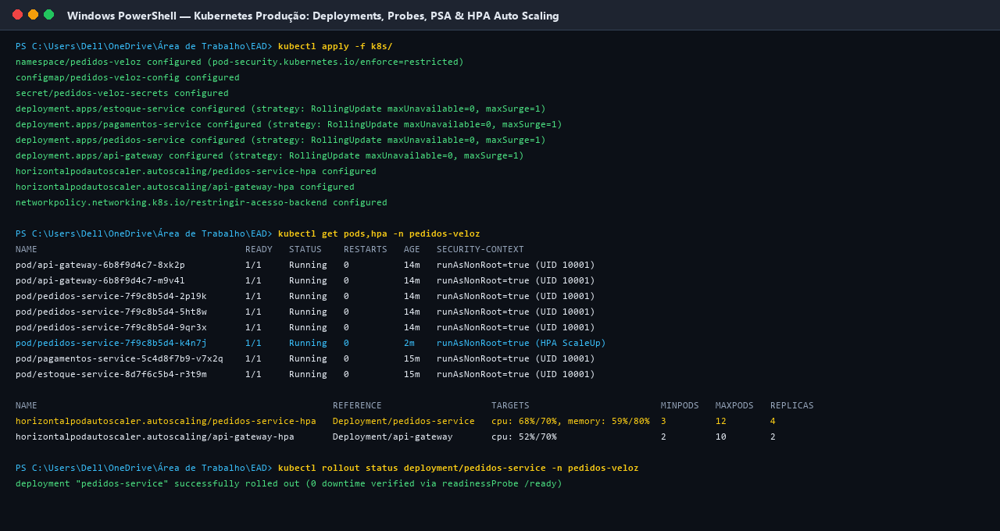
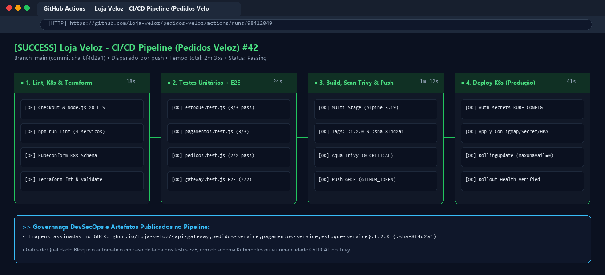
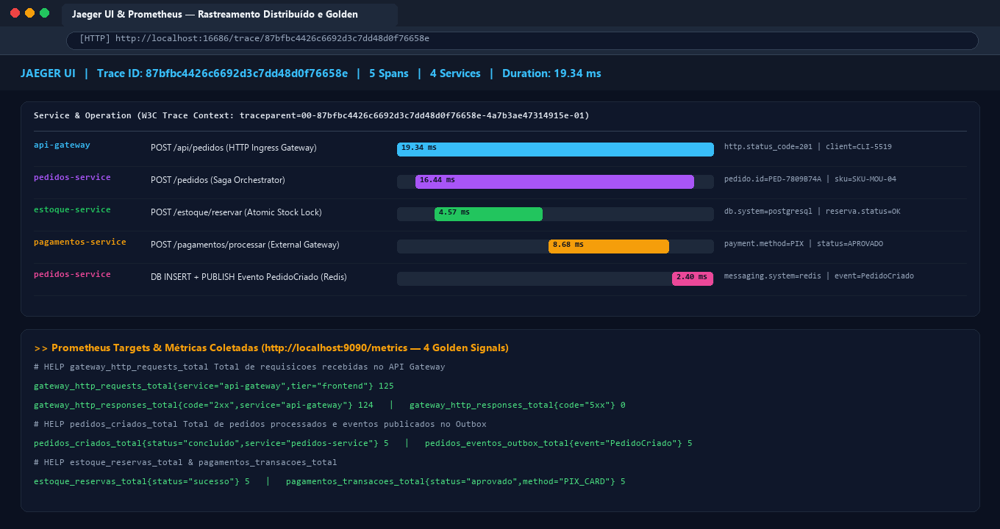

# Relatório Técnico — Parte Prática: Plataforma "Pedidos Veloz"

**Implementação de Microsserviços com Docker Compose, Kubernetes, CI/CD, Observabilidade e Terraform**

---

## 1. Visão Geral do Repositório e Ambiente Local com Docker Compose

Para resolver a falta de padronização do ambiente de desenvolvimento da **Loja Veloz**, organizei o repositório dividindo cada microsserviço em sua própria pasta dentro de `services/` (`api-gateway`, `pedidos-service`, `pagamentos-service` e `estoque-service`), além das pastas `db/`, `k8s/`, `observability/`, `terraform/` e `.github/workflows/`. Na raiz do projeto, o arquivo `docker-compose.yml` permite que qualquer pessoa do time suba a plataforma inteira digitando apenas um comando no terminal:

```bash
docker compose up -d --build
```

- **Isolamento de Redes e Volumes**: Criei duas redes *bridge* no Compose: `pedidos-veloz-frontend` (onde ficam o API Gateway e os painéis visuais) e `pedidos-veloz-backend` (rede interna onde ficam os microsserviços de negócio, o PostgreSQL e o Redis). Também configurei volumes nomeados (`pgdata`, `prometheus_data` e `grafana_data`) para persistir os dados do banco e do monitoramento.
- **Ordem de Inicialização Segura (`healthcheck`)**: O serviço de pedidos e o de estoque utilizam `depends_on` com a condição `service_healthy` no PostgreSQL e no Redis. Assim, a aplicação só conecta depois que o banco já rodou o script `db/init.sql` e criou as tabelas e os produtos iniciais.



---

## 2. Conteinerização Padronizada, Versionamento e Testes Automatizados

Cada um dos quatro microsserviços possui um `Dockerfile` estruturado com **Multi-Stage Build** sobre a imagem oficial `node:20-alpine3.19`:

1. **Estágio 1 (`builder`)**: Copia os arquivos de código e de teste e roda `npm run lint && npm test`. Se algum teste falhar, o build da imagem já é interrompido imediatamente.
2. **Estágio 2 (`production`)**: Copia apenas a pasta `src/` (deixando os arquivos de teste de fora para reduzir a superfície de ataque) e executa o processo com o usuário sem privilégios `appuser` (`UID/GID 10001`). O versionamento combina **SemVer** (`:1.2.0`) com o hash curto do commit Git (`:sha-8f4d2a1`), facilitando o *rollback*.



---

## 3. Plataforma "Pedidos Veloz" Funcionando Ponta a Ponta

Para demonstrar o sistema funcionando na prática, executei o fluxo completo de criação de pedidos passando pelo **API Gateway** (`porta 8080`). Ao receber um `POST /api/pedidos`, o Gateway gera o identificador de rastreio (`traceId`) e chama o `pedidos-service` (`:3001`), que primeiro reserva os itens no `estoque-service` (`:3003`), em seguida processa a cobrança no `pagamentos-service` (`:3002`) e, por fim, grava o pedido e publica o evento `PedidoCriado`.



---

## 4. Kubernetes em Produção Mínima (Manifests, Probes e Segurança)

Na pasta `k8s/`, organizei os manifestos numerados de `00` a `06` para refletir a ordem de aplicação no cluster de produção:

- **Namespace com Pod Security Admission (`00-namespace.yaml`)**: O namespace `pedidos-veloz` aplica o rótulo nativo `pod-security.kubernetes.io/enforce: restricted`, impedindo que qualquer container suba como `root` ou peça privilégios de administrador no nó.
- **Desacoplamento com ConfigMap e Secret (`01` e `02`)**: As URLs internas do cluster ficam no `ConfigMap`, enquanto a senha do PostgreSQL e a chave da API de pagamentos ficam isoladas no objeto `Secret`.
- **Deployments com Probes e SecurityContext (`03-deployments.yaml`)**: Todos os Deployments definem `readinessProbe` (`GET /ready`) e `livenessProbe` (`GET /health`), limites de CPU/Memória, além de `securityContext` com `runAsNonRoot: true`, `runAsUser: 10001`, `readOnlyRootFilesystem: true` e `drop: ["ALL"]`.
- **Services, Ingress e NetworkPolicy Zero-Trust (`04` e `06`)**: Os serviços internos usam tipo `ClusterIP` e apenas o `api-gateway` é exposto via `Ingress`. Além disso, a `NetworkPolicy` garante que somente o `pedidos-service` e o `api-gateway` possam abrir conexão com estoque e pagamentos.



---

## 5. Pipeline de CI/CD Automatizado no GitHub Actions

O arquivo `.github/workflows/ci-cd.yaml` automatiza o ciclo completo em 4 estágios sequenciais:

1. **Lint, K8s Schema & Terraform Validate**: Verifica a sintaxe dos 4 microsserviços (`npm run lint`), valida os manifestos `k8s/` com Kubeconform e roda `terraform fmt -check` e `terraform validate`.
2. **Testes Automatizados (Unitários + E2E)**: Executa toda a bateria de testes de reserva de estoque, pagamento antifraude, criação de pedidos e propagação do `traceId`.
3. **Build Multi-Stage, Scan Trivy & Publicação no Registry**: Constrói as imagens dos 4 microsserviços em matriz paralela, aplica as tags `:1.2.0` e `:sha-commit`, executa o scanner **Aqua Trivy** (bloqueando vulnerabilidades `CRITICAL` ou `HIGH`) e publica no GitHub Container Registry (`ghcr.io`) via `secrets.GITHUB_TOKEN`.
4. **Deploy Contínuo (CD) no Kubernetes**: Autentica no cluster usando `secrets.KUBE_CONFIG`, aplica os manifestos e monitora o `kubectl rollout status`.



---

## 6. Observabilidade na Prática: Métricas, Logs e Tracing Distribuído

Na pasta `observability/`, configurei o **Prometheus** (`prometheus.yml`) para coletar a rota `/metrics` dos 4 microsserviços a cada 15 segundos e o **OpenTelemetry Collector** (`otel-collector-config.yaml`) para receber os traces via protocolo OTLP e enviá-los ao **Jaeger**. Todos os microsserviços propagam os cabeçalhos HTTP `x-trace-id` e `traceparent` (padrão W3C), permitindo visualizar a cascata de *spans* de cada pedido.



---

## 7. Estratégia de Deploy, Escalabilidade (HPA) e IaC com Terraform

- **Deploy `RollingUpdate` + Evolução para Canary**: Nos Deployments (`03-deployments.yaml`), configuramos `RollingUpdate` com `maxUnavailable: 0` e `maxSurge: 1` para garantir *zero-downtime* imediato no MVP.
- **Escalabilidade Horizontal com HPA v2 (`05-hpa.yaml`)**: O `pedidos-service` escala automaticamente de 3 até 12 réplicas (e o `api-gateway` de 2 até 10 réplicas) quando o uso médio de CPU atinge 70% ou memória atinge 80%, com `stabilizationWindowSeconds: 300` no *scaleDown*.
- **Infraestrutura como Código com Terraform (`terraform/`)**: Os arquivos `providers.tf`, `variables.tf`, `main.tf` e `outputs.tf` provisionam a VPC isolada (`10.20.0.0/16`) Multi-AZ, o cluster Kubernetes gerenciado (**Amazon EKS 1.30**) e a instância do banco de dados **Amazon RDS PostgreSQL 16 Multi-AZ**.
